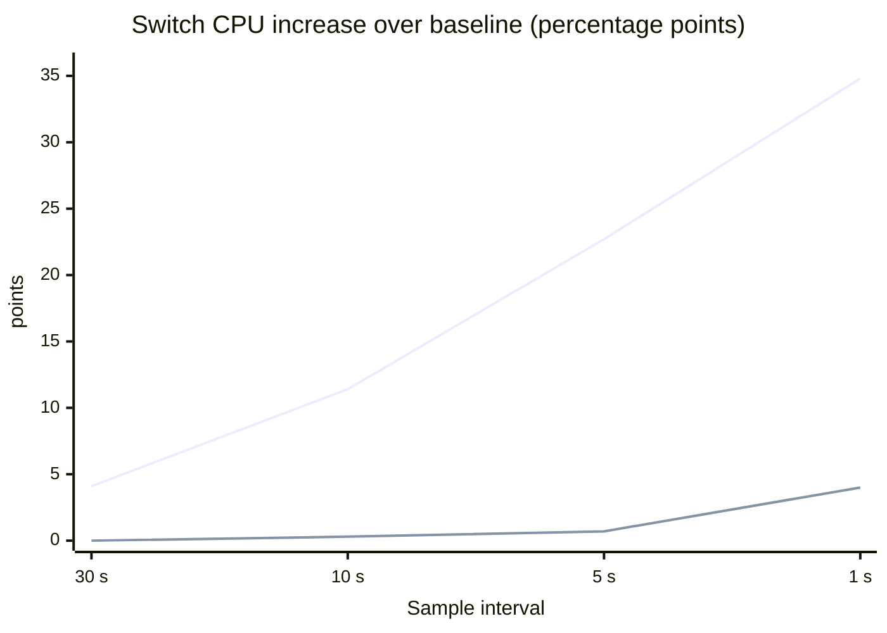

# MDT vs SNMP on sw98

Measurement on `ibk-lab-sw98` (Catalyst, IOS-XE 17.18), 16 Nov 2026. The same data from one switch, collected two
ways: gNMI streaming (MDT) and SNMPv3 authPriv (SHA/AES) polling of the matching MIBs.

- **Run 2** (`stress-20261116-143829`) pushes interface counters to 30, 10, 5 and 1 s, MDT alone and SNMP alone, and
  measures what one full MDT subscription set costs the switch.
- **Run 1** (`20261116-103628`) compares all ten data sets at the intervals used in production: 60 min MDT only,
  60 min MDT + SNMPv3, 15 min MDT + SNMPv2c.

## Verdict

| Question | Winner | Numbers |
|---|---|---|
| Switch CPU | **SNMP, clearly** | MDT's `ndbmand` +4 to +35 points; SNMP processes +0 to +4 |
| Short intervals (5 s, 1 s) | **SNMP keeps up** | MDT delivered 80 % of samples; SNMP 99–100 % |
| Rate accuracy | **MDT** | switch timestamps, no timing error; SNMP off by 1–16 % |
| Packets on the wire | **MDT**, a third to a half | bytes about even |

## Run 2: switch CPU vs interval

Streaming costs this switch more CPU than polling, and the gap grows as the interval shrinks.

Interface counters only, 15 minutes per step, one method at a time. Increase in 1-minute CPU over a 30-minute
baseline, for the process that does the work: `ndbmand` builds the YANG data MDT streams; SNMP is the sum of SNMP
ENGINE, IP SNMP and PDU DISPATCHER.

Upper line: MDT `ndbmand`. Lower line: SNMP processes.

| Interval | IOSd total, MDT | IOSd total, SNMP | Platform total, MDT | Platform total, SNMP |
|---|--:|--:|--:|--:|
| 30 s | +1.3 | +0.1 | +2.4 | −0.2 |
| 10 s | +3.9 | +0.5 | +6.9 | +0.5 |
| 5 s | +8.7 | +1.6 | +13.9 | +1.6 |
| 1 s | +17.9 | +6.1 | +21.5 | +2.6 |

Percentage points over a baseline of IOSd 4.0 % and platform 11.7 %. MDT used the same YANG paths as production
(`Cisco-IOS-XE-interfaces-oper`, ten leaves). A different model (OpenConfig) or fewer leaves may cost less; not tested.

## Run 2: delivery and accuracy

Below 10 s the switch drops MDT samples. SNMP rates carry timing error that MDT does not have: MDT samples carry the
switch's own timestamp, while SNMP has none, so the rate uses the collector's clock and walk duration and jitter go
straight into it.

| Interval | Delivered, MDT | Delivered, SNMP | Longest gap, MDT | SNMP rate error p50 / p95 | Packets/h, MDT | Packets/h, SNMP |
|---|--:|--:|--:|--:|--:|--:|
| 30 s | 100 % | 100 % | 30.0 s | 0.8 / 1.0 % | 11.6k | 26.2k |
| 10 s | 100 % | 100 % | 10.1 s | 1.7 / 2.0 % | 34.7k | 78.5k |
| 5 s | **80 %** | 100 % | **47.5 s** | 3.2 / 3.6 % | 71.8k | 157k |
| 1 s | **81 %** | 98.6 % | **4.1 s** | **16 / 22 %** | 239k | 773k |

SNMP walk time stayed at 160–230 ms p50 at every interval; at 1 s, 12 of 900 polls were missed and one walk took
5.2 s. Bytes per hour were about even (MDT 159 MB vs SNMP 206 MB at 1 s). Collector CPU at 1 s: SNMP poller 5.1 % of a
core, bench gnmic 1.1 % (the poller starts one `snmpbulkwalk` process per walk, which inflates its share).

## Run 2: cost of one MDT set

A second gnmic subscribed an identical copy of all ten production subscriptions for 30 minutes.

| Process | Baseline | + second set | Change |
|---|--:|--:|--:|
| ndbmand | 4.8 % | 14.5 % | +9.7 |
| IOSd total | 4.0 % | 8.0 % | +4.0 |
| Platform total | 11.7 % | 17.9 % | +6.2 |
| pubd | 0.0 % | 1.0 % | +1.0 |

For comparison, Run 1: polling all ten data sets over SNMPv3 at the same intervals cost the SNMP processes +0.16 points.

## Run 1: all ten data sets at production intervals

### Time per sample

At equal intervals both are equally fresh (the newest value is on average half an interval old either way). MDT
delivers each sample a little faster.

| Data set | MDT: switch timestamp to collector, p50 | SNMPv3 walk, p50 |
|---|--:|--:|
| Interface counters | 35 ms | 170 ms |
| CPU | 22 ms | 42 ms |
| CDP | 24 ms | 45 ms |
| Interface info | 34 ms | 164 ms |
| MAC table | 37 ms | 760 ms |
| Inventory | 34 ms | 124 ms |

MDT delivery p95 stays under 60 ms for every subscription except ARP (157–177 ms).

### Collection time

One full SNMP pass takes 1.5 s, and the MAC table is half of it: it needs one walk per VLAN (19 here).

| Data set | Interval | Values | v3 p50 | v3 max | v2c p50 |
|---|--:|--:|--:|--:|--:|
| MAC table (19 VLANs) | 300 s | 166 | 760 ms | 796 ms | 325 ms |
| Interface counters | 30 s | 1,071 | 170 ms | 5,180 ms | 134 ms |
| Interface info | 300 s | 1,071 | 164 ms | 222 ms | 131 ms |
| Inventory | 3600 s | 918 | 124 ms | 124 ms | 83 ms |
| PoE | 300 s | 293 | 70 ms | 86 ms | 43 ms |
| Memory | 300 s | 12 | 48 ms | 55 ms | 22 ms |
| ARP | 300 s | 68 | 46 ms | 64 ms | 21 ms |
| CDP | 60 s | 66 | 45 ms | 68 ms | 21 ms |
| CPU | 60 s | 28 | 42 ms | 59 ms | 18 ms |
| LAG | 300 s | 1 | 41 ms | 54 ms | 17 ms |
| **Full pass** | | 3,694 | **1,510 ms** | | **814 ms** |

The 5.2 s maximum for interface counters is a single slow walk out of 120; p95 was 199 ms.

### Wire

Same bytes, twice the packets. Traffic between switch and collector per hour, both directions:

| | Bytes/h | Packets/h |
|---|--:|--:|
| MDT (gNMI, TLS) | 9.26 MB | 15.9k |
| SNMPv3 | 8.70 MB | 32.6k |
| SNMPv2c | 6.05 MB | 32.2k |

SNMP sends one request per response packet, so its packet count is twice that of the stream.

### Switch CPU

| Process | MDT only | MDT + SNMPv3 | Change |
|---|--:|--:|--:|
| SNMP ENGINE | 0.05 % | 0.15 % | +0.10 |
| IP SNMP | 0.01 % | 0.05 % | +0.04 |
| PDU DISPATCHER | 0.00 % | 0.02 % | +0.02 |
| IOSd total | 4.03 % | 4.02 % | 0.0 |
| Platform total | 11.83 % | 11.53 % | −0.3 |
| ndbmand | 4.82 % | 4.68 % | −0.1 |

## How to read this

On this switch MDT does not win on cost. Streaming interface counters costs the switch noticeably more CPU than
polling the same counters, and below 10 s the switch cannot sustain the stream while SNMP still can.

MDT's measurable advantages are data quality and transport: every sample carries the switch's timestamp, so rates are
exact; it sends a third to half the packets; and the collector needs no polling cycle. At equal intervals the data is
equally fresh.

Not tested: on-change subscriptions (the switch pushes only when a value changes, which polling cannot match without
polling fast), many switches against one collector, other YANG models (OpenConfig), and other platforms. One switch,
one IOS-XE release: do not generalise.

## Method

- Data sets match the ten gnmic subscriptions of sw98; the MIB mapping is in [README.md](README.md#data-sets-and-mib-mapping).
- Poller: net-snmp `snmpbulkwalk` in a container on the collector host, read-only SNMP access limited to that host by ACL.
- Switch CPU: `show processes cpu` and `show processes cpu platform` once a minute over SSH; the 1-minute column.
- Run 1 measured the production MDT stream passively from NATS. Run 2 used a separate bench gnmic writing to a file
  (never to the production NATS), so the production stream for sw98 kept running unchanged as a constant background.
- Collector CPU in Run 2 from cgroup counters. Clocks NTP-synced.
- Code: this directory. Runs `20261116-103628` (Run 1) and `stress-20261116-143829` (Run 2) on the test host.
